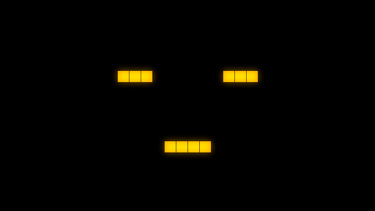
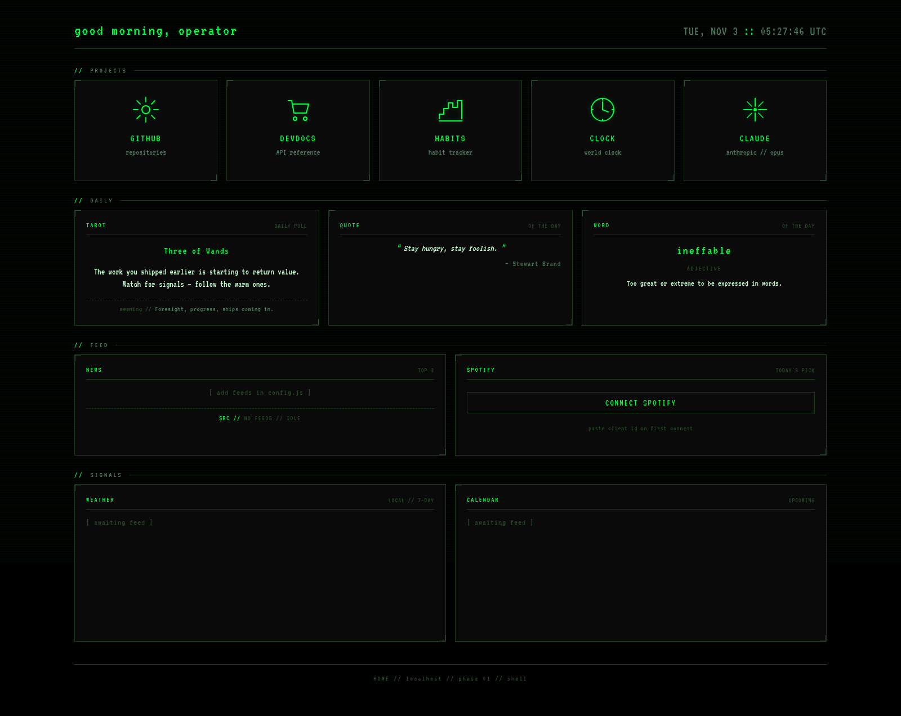

# SelfCheckout rice

A phosphor-green CRT desktop theme for Ubuntu 22.04 with GNOME 42 on X11, plus GRTA: a fullscreen pixel face that sits on the desktop and changes expression with the time of day. One palette and two fonts are carried through every visible surface (terminal, editor, browser chrome, GTK apps, the GNOME panel, a browser new-tab dashboard), and an optional OpenGL overlay adds scanlines, grain and signal glitches on top of everything.

GRTA is inspired by the AI of the same name in the series *Maniac*. No images or other assets from the show are used; the faces are 16x12 grids drawn in this repository.



*The GIF is rendered from the face grids and colors in `config/conky/grta/face.lua`; on the desktop the face is drawn by conky at 45 px per cell.*

| GRTA on the desktop | New-tab dashboard |
|---|---|
|  |  |

## Components

| Component | What | Path |
|---|---|---|
| Fonts | VT323 (body and data), Major Mono Display (headers), with their OFL licenses | `fonts/` |
| Terminal | gnome-terminal profile, kitty config with a tiled 3x3 scanline background | `gnome-dconf/terminal.dconf`, `config/kitty/` |
| Editor | VS Code `workbench.colorCustomizations` and `editor.tokenColorCustomizations` | `config/Code/User/settings.json` |
| GTK 3 and 4 | Additive `gtk.css` overrides on Yaru-dark via `@define-color` | `config/gtk-3.0/`, `config/gtk-4.0/` |
| Browsers | `userChrome.css`, `userContent.css` and theme-only `user.js` for Firefox and LibreWolf | `browsers/` |
| New-tab dashboard | Static page served on `127.0.0.1:8080`: launchers, daily tarot, quote and word, RSS news, Spotify | `browsers/librewolf/newtab/` |
| GRTA | Conky + Lua + Cairo fullscreen face with a time-of-day mood schedule, blinking, idle eye drift and a night animation | `config/conky/grta/` |
| GNOME Shell | Minimal panel theme on top of Yaru (fragile, see Known issues) | `themes/SelfCheckout/` |
| CRT overlay | Click-through X11/OpenGL overlay: scanlines, grain, drift band, glitch, vignette | `overlay/` |
| Scripts | Wallpaper and GRTA toggles, a small-font kitty launcher | `scripts/` |

## Technically notable parts

**GRTA mood schedule.** `config/conky/grta/moods.lua` maps hour ranges to faces (defaults: morning, afternoon, evening, night). Ranges are half-open and may wrap past midnight; `face.lua` falls back to the same defaults if the file is missing. Eight faces are defined as 16x12 character grids, where `e` cells are eyes that blink and can show a drifting pupil.

**CRT overlay** (`overlay/main.c`, 419 lines of C). A click-through X11 window (an empty XShape input region) with a 32-bit ARGB visual, drawn by a GLSL fragment shader that ports the CSS effect stack (scanlines, fractal grain, a drifting band, timed signal glitches, vignette). It reads per-monitor opacity from `config.ini`, drops to a lower opacity on battery, freezes the animation when GNOME's reduced-motion setting is on, and toggles visibility on `SIGUSR1` without re-initializing GL. Known limitation: it does not follow monitor hotplug.

**New-tab dashboard.** One static HTML file with no build step, served by `python3 -m http.server` from a systemd user unit bound to `127.0.0.1` (a real origin is needed for OAuth redirects and CORS). Spotify uses the Authorization Code flow with PKCE: the client ID is entered once at runtime and only tokens are kept in `localStorage`, so no secret ships with the page. Daily widgets are keyed to the date and re-render at midnight. Personal settings (greeting name, launcher links, weather label, news feeds) live in `config.js`; the news list ships empty.

**Firefox chrome CSS.** Custom properties do not resolve on top-level XUL chrome selectors, so all chrome CSS uses literal colors. The window is forced opaque (`mozilla.widget.use-argb-visuals = false`) because the compositor otherwise shows other windows through the top of the chrome.

## Palette and type

| Role | Color |
|---|---|
| Background | `#000000` |
| Raised panel | `#0a0a0a` |
| Border, dim | `#1a3a1a` |
| Body text | `#c0ffcc` |
| Muted text | `#4a7a5a` |
| Primary accent | `#00ff41` |
| Secondary green | `#00cc33` |
| Errors | `#ff0033` |
| Warnings, only warm accent | `#ffaa00` |

There is no cyan or blue: ANSI slots 4, 5 and 6 are mapped to dim greens. Headers use Major Mono Display; everything else uses VT323.

## Install

Requirements: Ubuntu 22.04, GNOME 42 on X11 (other Debian-family GNOME setups mostly work; the shell theme is the fragile part).

```bash
git clone https://github.com/elijahsylar/rice-selfcheckout.git ~/rice-selfcheckout
cd ~/rice-selfcheckout
./install.sh --dry-run   # show every step
./install.sh             # apt + flatpak packages, fonts, stow-linked configs, dconf, browser chrome
./install.sh --no-sudo   # skip the apt/sudo steps
```

The installer backs up what it replaces to `~/rice-backups/<timestamp>/` and is safe to re-run. The repository is expected at `~/rice-selfcheckout` (the dashboard unit and overlay toggle use that path).

After installing: log out and back in, switch gnome-terminal to the SelfCheckout profile, and restart Firefox and LibreWolf so the chrome CSS loads.

Optional:
- **CRT overlay**: `make -C overlay` (needs `libx11-dev`, `libxext-dev`, `libgl-dev`), then bind `overlay/toggle.sh` to a key.
- **Green cursor**: the matching cursor theme is not bundled; [kde69420/Oxygen-Green-Cursor](https://github.com/kde69420/Oxygen-Green-Cursor) is a green recolor of KDE's Oxygen cursors.
- **GRTA schedule**: edit `~/.config/conky/grta/moods.lua`.
- **Dashboard**: edit `browsers/librewolf/newtab/config.js`.

### Checks

```bash
tests/run.sh
```

Runs the GRTA schedule tests (Lua, 48 checks: hour-to-face mapping, wrap-around ranges, every scheduled face exists, every grid is 16x12), `bash -n` on every script, a parse of the dashboard's JavaScript, and an overlay build if the X11/GL headers are present.

## Known issues

- **GNOME Shell theming is fragile on Ubuntu 22.04 with Yaru.** If the panel disappears after reloading the shell, revert with `dconf write /org/gnome/shell/extensions/user-theme/name "''"` and reload again.
- **The CRT overlay works on one monitor.** Hotplug or reconfiguration drops the effect; it needs an XRandR `RRScreenChangeNotify` listener.
- **Conky with the `override` window type** fails with `BadMatch` on GNOME/Mutter with ARGB visuals; the configs use the `desktop` type instead.

## Project status

A personal desktop setup, in daily use on one machine and shared as-is.

## License

MIT for the code and configs (see [LICENSE](LICENSE)). The fonts in `fonts/` are under the SIL Open Font License; their license texts are next to them.
